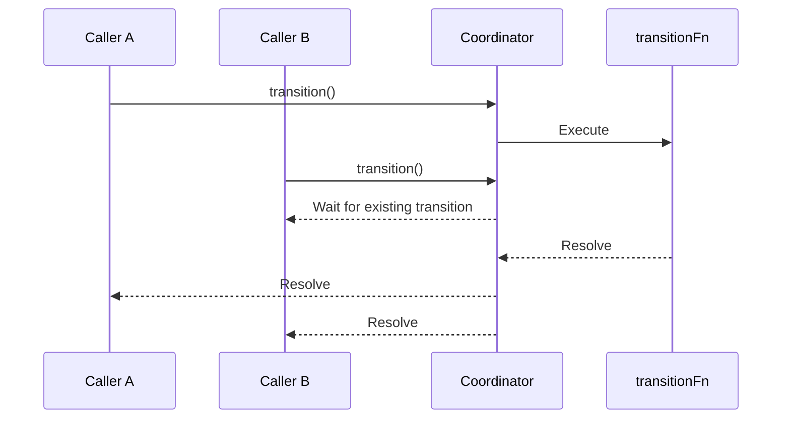
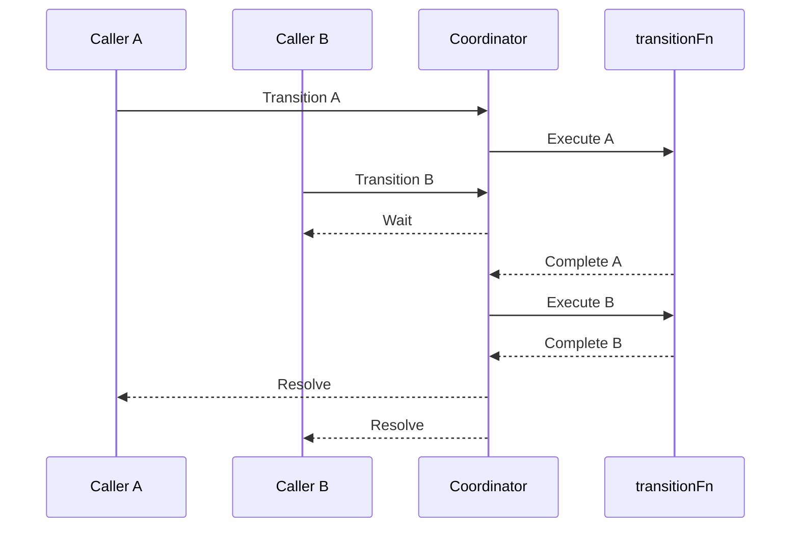

# Coalescing Transition

`createCoalescingTransition` provides a synchronization primitive for asynchronous state transitions.

It prevents conflicting transitions from executing concurrently while allowing multiple calls targeting the same state to share a single operation.

Unlike a mutex, it does not simply queue every invocation. Instead, it applies a coalescing policy:

- Calls targeting the currently executing transition join its completion.
- Calls targeting another state wait for the current transition and then attempt to execute.
- Calls targeting an already reached state complete immediately without executing anything.

This makes it particularly useful for lifecycle management, resource initialization, connection management, and other asynchronous stateful operations.

## Usage

```typescript
import { createCoalescingTransition } from "@shinka-rpc/concurrency";

const transition = createCoalescingTransition("stopped");

const start = transition(
  "started",
  "starting",
  async () => {
    await initialize();
  },
  () => dispatch("starting"),
  () => dispatch("started"),
  () => dispatch("start-error"),
);

const stop = transition(
  "stopped",
  "stopping",
  async () => {
    await cleanup();
  },
  () => dispatch("stopping"),
  () => dispatch("stopped"),
  () => dispatch("stop-error"),
);

// Multiple calls to start share the same operation.
await Promise.all([
  start(),
  start(),
  start(),
]);
```

## API

### `createCoalescingTransition<T>(initialState)`

Creates a coalescing transition coordinator.

**Parameters**

| Parameter | Type | Description |
|---|---|---|
| `initialState` | `T` | Initial state of the coordinator. |

**Returns**

A transition factory accepting the following arguments:

| Parameter | Type | Description |
|---|---|---|
| `stateTarget` | `T` | State to reach after successful completion. |
| `statePending` | `T` | Temporary state indicating that the transition is executing. |
| `transitionFn` | `() => Promise<void>` | Asynchronous operation performing the transition. |
| `dispatchBegin` | `() => void` | Called when the transition begins. |
| `dispatchOK` | `() => void` | Called when the transition completes successfully. |
| `dispatchErr` | `() => void` | Called when the transition fails. |

The returned function initiates the transition and returns a `Promise<void>`.

### State semantics

The coordinator maintains two pieces of internal state:

- The current state.
- The Promise representing the currently executing transition, if any.

The `statePending` value identifies the transition currently in progress. It must be distinguishable from other stable states that may be used by the same coordinator.

State comparisons use strict equality (`===`).

## Execution semantics

### Identical transitions

When multiple calls target the same transition while it is executing, they join the existing operation rather than starting additional executions.



All participating calls settle according to the same underlying operation.

### Conflicting transitions

When a call targets a different state while another transition is executing, it waits for the current operation to settle and then evaluates its own transition again.



If the current transition fails, waiting calls still proceed. They evaluate the state restored by the failed operation before deciding whether their own transition should execute.

**Important:** The coordinator guarantees mutual exclusion, but does not guarantee FIFO ordering between competing transitions. When deterministic FIFO execution is required, use a transition queue instead.

### Already reached state

If the coordinator is already in the requested target state and no transition is executing, the call completes immediately.

Neither `transitionFn` nor the dispatch callbacks are invoked.

## Lifecycle callbacks

The callbacks represent the lifecycle of an individual transition:

| Callback        | Invocation                                            |
| --------------- | ----------------------------------------------------- |
| `dispatchBegin` | Synchronously, before `transitionFn` executes.        |
| `dispatchOK`    | Synchronously, after the target state is established. |
| `dispatchErr`   | Synchronously, after the previous state is restored.  |

A transition failure is propagated to all calls participating in that operation. The original state is restored, allowing subsequent calls to retry or initiate another transition.

Exceptions thrown by lifecycle callbacks are caught and reported using console.trace(). They do not affect transition execution or its outcome.

## Guarantees and limitations

`createCoalescingTransition` provides the following guarantees:

- **Mutual exclusion:** At most one `transitionFn` executes at a time within a coordinator.
- **Coalescing:** Concurrent calls targeting the currently executing transition share its execution.
- **State consistency:** The target state is established only after successful execution.
- **Rollback:** Failed transitions restore the previous state.
- **Retryability:** A failed transition does not permanently lock the coordinator.
- **No-op transitions:** Requests targeting an already reached state do not execute.

The coordinator does not guarantee:

- FIFO ordering between competing transitions.
- Cancellation of an executing transition.
- Cancellation of waiting calls.
- Recovery of external side effects performed before a transition fails.

Each coordinator owns its own state and synchronization mechanism. To coordinate operations over the same state machine, reuse the same coordinator instance.

## When to use

Use `createCoalescingTransition` when repeated requests for the same state should collapse into one operation, while conflicting requests should wait for the current operation to finish.

Typical use cases include:

- Starting and stopping connections.
- Resource initialization and cleanup.
- Reconnecting stateful services.
- Asynchronous lifecycle management.

For operations that must execute in strict invocation order without coalescing, use [`TransitionQueue`](./transition-queue.md) instead.
