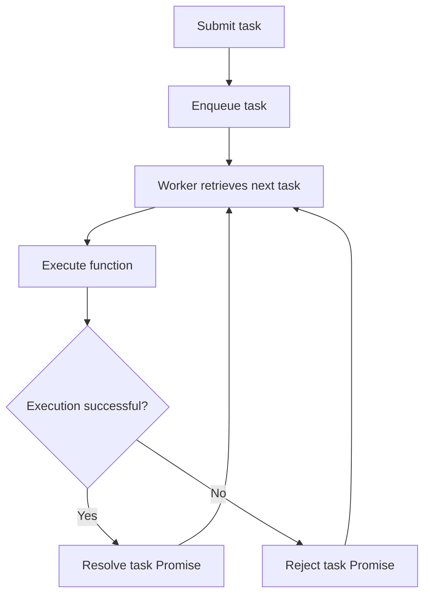

# Transition Queue

`TransitionQueue` is an asynchronous task queue that guarantees sequential execution of submitted functions.

It allows multiple asynchronous operations to be scheduled concurrently while ensuring that only one operation is executing at any given time.

Unlike [`createCoalescingTransition`](./coalescing-transition.md), which coalesces concurrent requests targeting the same state, `TransitionQueue` preserves every submitted operation and executes them in FIFO order.

## How it works

A `TransitionQueue` consists of two parts:

- An underlying [`Asynq`](./asynq.md) instance that stores pending tasks.
- A worker that continuously retrieves and executes tasks from the queue.

Each submitted task consists of:
- The function to execute.
- Its arguments.
- Promise resolution and rejection callbacks.

When a task is submitted, its execution is deferred until the worker retrieves it. The returned Promise settles with the result of the corresponding function.

If a task throws an exception or returns a rejected Promise, only its corresponding Promise is rejected. The worker continues processing subsequent tasks.

### Execution flow



The worker awaits each task before retrieving the next one. Therefore, task execution is strictly sequential, and the execution order follows the queue's FIFO order.

## API

### `createTransitionQueue(q)`

Creates a `TransitionQueue` backed by the supplied `Asynq` instance.

```typescript
function createTransitionQueue(q: Asynq<any>): TransitionQueue
```

The worker starts immediately and continuously processes tasks from the queue.

The returned `TransitionQueue` is a function factory that wraps asynchronous functions into queue-aware functions.

### `TransitionQueue`

```typescript
type TransitionQueue = <A extends unknown[], R>(
  transitionFn: (...args: A) => Promise<R>
) => (...args: A) => Promise<R>;
```

Wraps an asynchronous function so that its invocations are executed sequentially.

Each invocation:
1. Creates a Promise associated with the invocation.
2. Adds the function, its arguments, and Promise callbacks to the queue.
3. Returns the Promise.

The Promise resolves with the function's return value or rejects with the exception thrown during its execution.

## Example

```typescript
import { Asynq, createTransitionQueue } from "@shinka-rpc/concurrency";
import { FIFO } from "@shinka-rpc/collections";

const queue = createTransitionQueue(
  new Asynq({ items: FIFO, waiters: FIFO })
);

const task = queue(async (value: string) => {
  console.log("BEGIN", value);

  await new Promise((resolve) => setTimeout(resolve, 100));

  console.log("END", value);
  return value;
});

const results = await Promise.all([
  task("A"),
  task("B"),
  task("C"),
]);

console.log(results); // ["A", "B", "C"]
```

Even though all three invocations are submitted concurrently, their execution is sequential.

The resulting execution order is:

```text
BEGIN A
END A
BEGIN B
END B
BEGIN C
END C
```

## Execution guarantees

- **FIFO ordering:** Tasks are executed in the order they are submitted, provided the underlying queue preserves FIFO ordering.
- **Mutual exclusion:** At most one task executes at a time.
- **Error isolation:** A failed task does not prevent subsequent tasks from executing.
- **Promise association:** Every invocation receives a Promise settled with the result of its own execution.

`TransitionQueue` does not provide cancellation, task prioritization, or worker lifecycle management. Its worker runs continuously and waits for new tasks through the underlying `Asynq` instance.
