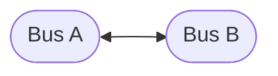
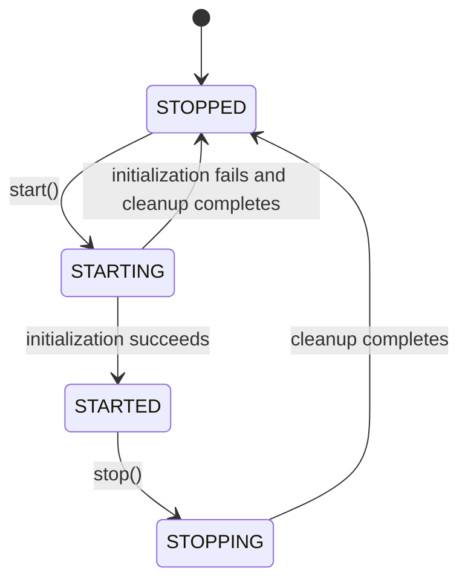
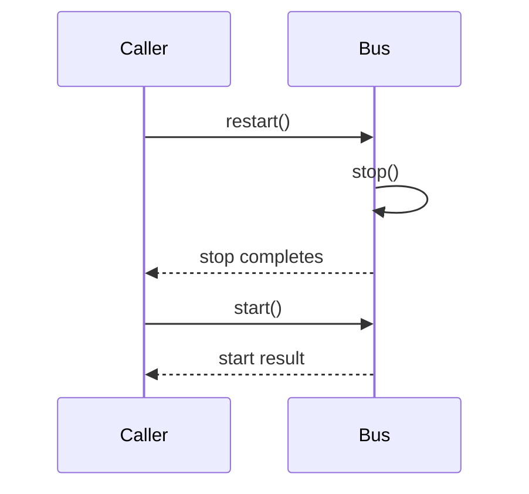
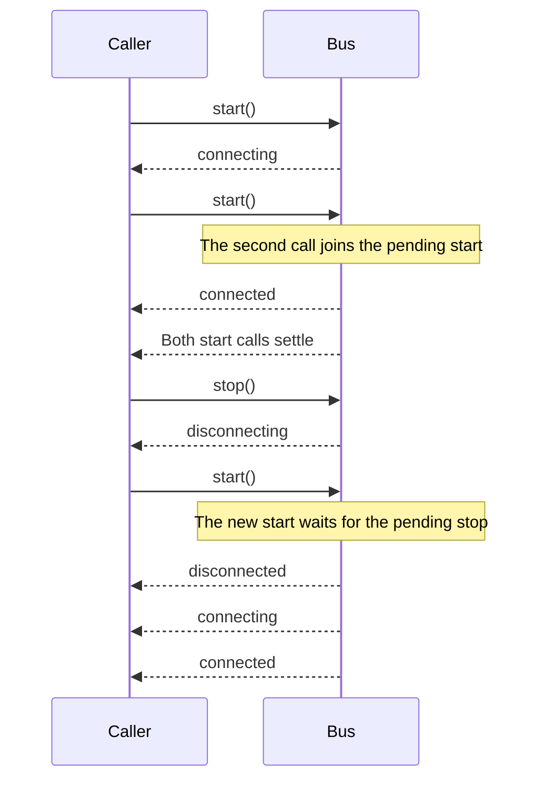

# Bus

`Bus` is the connection-level primitive of `@shinka-rpc/core`. It provides the
lifecycle and messaging operations used by higher-level components such as
[`Client`](./client.md), [`Server`](./server.md), [`Pool`](./pool.md), and
[`Hub`](./hub.md).

A `Bus` represents a connection, not an endpoint role. Both sides of a connection—for example, two dedicated workers—can use a `Bus`-based abstraction.

## Connection model

A `Bus` always represents exactly **one connection**:

The objects on both sides are peers. `Bus` does not distinguish between a
"client" and a "server".

Higher-level abstractions determine how connections are organized:

| Type     | Relationship                       |
| -------- | ---------------------------------- |
| `Client` | one-to-one                         |
| `Server` | one-to-many                        |
| `Hub`    | one-to-many connection manager     |
| `Pool`   | reusable collection of connections |

See the respective documentation for [`Client`](./client.md),
[`Server`](./server.md), [`Hub`](./hub.md) and [`Pool`](./pool.md).

## Responsibilities

A `Bus` coordinates the components required to exchange messages:

- **Transport** — moves serialized data between peers.
- **Serializer** — converts application data to and from the transport representation.
- **LiMon** — optionally monitors connection liveness.
- **Lock** — optionally coordinates exclusive access to the outgoing channel.
- **Outscope** — integrates the connection with an external lifecycle.

These components are configurable. A `Bus` does not require every optional component to be present.

## Lifecycle

A `Bus` has four lifecycle states:

| State | Meaning |
| --- | --- |
| `STOPPED` | No active Bus lifecycle. |
| `STARTING` | The connection is being initialized. |
| `STARTED` | The connection has been initialized successfully. |
| `STOPPING` | The connection is being shut down. |

The normal lifecycle is:

### Starting

`start()` initializes the components required for the connection and prepares the `Bus` to exchange messages.

When initialization succeeds, the state becomes `STARTED` and the `connected` event is dispatched.

If initialization fails:

1. The original error is reported through the `error` event.
2. Cleanup is attempted for the resources initialized so far.
3. Cleanup errors are also reported, without replacing the original startup error.
4. The lifecycle returns to `STOPPED`.
5. The `start()` call rejects with the original startup error.

A failed start does not permanently disable the instance. After cleanup completes, the `Bus` can be started again.

### Stopping

`stop()` attempts to shut down the connection and clean up its resources. The lifecycle returns to `STOPPED` even when individual cleanup operations fail.

Errors encountered during shutdown are reported through the `error` event. They do not prevent subsequent cleanup steps from being attempted, and they do not cause `stop()` to reject merely because a cleanup operation failed.

This is a best-effort cleanup guarantee: the `Bus` restores its internal lifecycle state, but it cannot guarantee that an external resource was successfully released when its own cleanup operation failed.

Once cleanup completes, the `disconnected` event is dispatched.

### Restarting

`restart()` performs a stop followed by a start:

Because shutdown reports cleanup failures through `error` rather than rejecting `stop()`, a cleanup failure alone does not prevent `restart()` from proceeding to `start()`. If the subsequent start fails, the restart operation rejects with the startup error.

## Concurrent lifecycle calls

Lifecycle transitions are serialized. A `Bus` does not run its start and stop transition procedures concurrently.

Concurrent calls are coordinated according to the transition already in progress:

- Calls requesting the same pending transition wait for its outcome.
- Calls requesting the opposite transition wait for the current transition to settle, then re-evaluate the current state.
- If the requested target state has already been reached, the operation can complete without starting another transition.
- After a failed transition has been cleaned up, subsequent lifecycle operations can proceed.

For example, a `stop()` called while startup is pending waits for startup to settle before determining whether shutdown is needed.

The exact interleaving of caller continuations is not part of the lifecycle contract. In particular, code awaiting several lifecycle calls must not assume that its own completion markers will be observed before the next lifecycle event.

## Events

A `Bus` exposes the following event types:

| Event | Meaning |
| --- | --- |
| `connecting` | A transition to `STARTING` has begun. |
| `connected` | Initialization succeeded and the `Bus` reached `STARTED`. |
| `disconnecting` | A transition to `STOPPING` has begun. |
| `disconnected` | Shutdown or failed-start cleanup has completed and the `Bus` reached `STOPPED`. |
| `error` | An error occurred during initialization or cleanup. |

Lifecycle events are dispatched asynchronously using `queueMicrotask`. Do not treat event listeners as synchronous callbacks of `start()` or `stop()`.

The lifecycle event sequence describes the `Bus` state transitions. It does not impose a global ordering on unrelated callbacks, promise continuations, or logging performed by application code.

## Messaging API

`Bus` provides operations for application-level messaging:

- `request()` — sends a request and returns a promise for its response.
- `dataEvent()` — sends a data event.
- `onRequest()` — registers request handlers.
- `onDataEvent()` — registers data-event handlers.
- `ping()` — measures round-trip time.
- `exclusiveLock()` — reserves exclusive access to the outgoing channel.
- `extra` — exposes the additional data associated with the `Bus`.

### Requests and cancellation

Requests support per-call timeout configuration and cancellation through
`AbortSignal`.

The `request()` method accepts optional metadata that can configure the
transport and serialization, specify a timeout, and provide an abort signal.
This allows individual requests to override the default response timeout or to
be cancelled in response to application events.

The `onRequest()` method registers a handler that receives the request data, its
`thisArg`, and a `taskCtl` object containing an `AbortSignal`. The handler can
use this signal to observe cancellation initiated by the requesting side and
stop work that is no longer needed.

Request handlers can therefore cooperate with cancellation-aware APIs, including
APIs that accept an `AbortSignal`.

Timeouts and cancellation serve related but distinct purposes:

- **Timeout** — limits how long a request waits for a response.
- **Cancellation** — communicates that the caller no longer needs the result and
allows the handler to stop unnecessary work.

Cancellation is cooperative. Receiving an abort signal does not automatically
terminate arbitrary JavaScript execution; the handler must observe the signal
and respond appropriately.

See the `request()` and `onRequest()` API documentation for their exact metadata
contracts and cancellation behavior.

### Exclusive access

An exclusive lock reserves the outgoing channel for a critical section. Messages
produced while the lock is held can be buffered and sent when the lock is
released.

The reservation concerns writing to the transport: it does not necessarily mean
that no messages are pending in memory. This can be useful for operations such
as rotating a serialization or encryption key without interleaving writes that
use different configurations.

The precise behavior of messaging operations depends on the configured
transport, serializer, and optional components.

## Configuration

A `Bus` is configured through `BusProps`:

| Property | Required | Purpose |
| --- | --- | --- |
| `outscope` | Yes | Integrates the connection with an external lifecycle. |
| `transport` | Yes | Provides the underlying communication transport. |
| `serializer` | No | Configures message serialization. |
| `limon` | No | Configures optional liveness monitoring. |
| `lock` | No | Configures optional exclusive-channel coordination. |
| `responseTimeout` | No | Configures the response timeout. |

The default serializer configuration uses an array root. Transport and serializer implementations can provide additional configuration options.

## Lifecycle guarantees

The lifecycle implementation is designed to provide the following guarantees:

- At most one lifecycle transition procedure is active at a time.
- Concurrent calls targeting the same pending transition share its outcome.
- Opposite transitions are serialized and re-evaluate the state before proceeding.
- A failed start attempts cleanup, reports the original error, and restores the internal state to `STOPPED`.
- Shutdown attempts all applicable cleanup steps, reports cleanup errors, and restores the internal state to `STOPPED`.
- The instance remains eligible for a subsequent lifecycle operation after a transition failure.
- Lifecycle events describe the transition and resulting state; they do not guarantee ordering relative to unrelated application-level continuations.

These guarantees concern the `Bus` lifecycle and its internal state. They do not guarantee that a failing external transport or integration has successfully released every resource.
