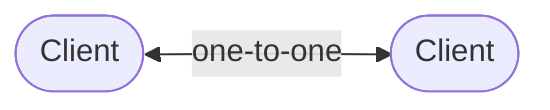
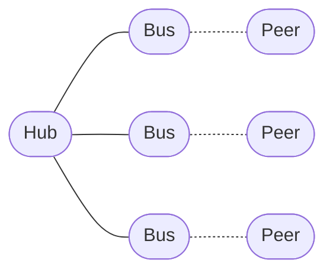

# Client

`Client` is a one-to-one communication endpoint in `@shinka-rpc/core`.

It represents a communication relationship between exactly two peers. The term *client* does not imply a client/server role: both sides of a connection may be represented by a `Client`.

For example, when communicating with a `DedicatedWorker`, both the page and the worker can use `Client`:



`Client` extends [`Bus`](./bus.md), inheriting its connection lifecycle and messaging capabilities while providing a user-facing abstraction for one-to-one communication.

For one-to-many communication, `@shinka-rpc/core` provides [`Hub`](./hub.md), which manages a collection of `Bus` instances.

## Installation

```bash
npm install @shinka-rpc/core
```

## Quick start

A `Client` requires an `OutScope` and a transport. Serialization, liveness monitoring, and exclusive locking can be configured independently.

```ts
import { Client } from "@shinka-rpc/core";
import outscope from "@shinka-rpc/outscope/browser-page";
import { sharedWorkerClient } from "@shinka-rpc/shared-worker";
import serializer from "@shinka-rpc/serializer-msgspec";

const transport = sharedWorkerClient(
  () => new SharedWorker(new URL("./worker.ts", import.meta.url)),
);

export const client = new Client({ outscope, transport, serializer });

client.addEventListener("error", console.error);

client.start();
```

See [`@shinka-rpc/outscope`](../outscope.md) for `OutScope`.

See [Transport documentation](../transports/) for transports.

See [Serializer documentation](../serializers/) for serializers.

See [LiMon documentation](../limons/) for liveness monitoring.

See [Exclusive Lock documentation](../exclusive-lock.md) for exclusive locking.

See [Transport Context](./transport-context.md) for accessing transport-specific context.

## Requests

A request sends data to the remote peer and waits for its response.

```ts
type User = { /* ... */ };

const user = await client.request<User>("get-user", { id: 42 });
```

Requests are identified by an application-defined `key`. The payload can contain arbitrary application data supported by the configured serializer.

The remote peer handles the request with `onRequest()`:

```ts
client.onRequest("get-user", async (data) => {
  return await getUser(data.id);
});
```

The callback may return a value synchronously or asynchronously. Its result becomes the response to the request.

### Request metadata

The optional metadata argument allows you to configure an individual request:

```ts
const controller = new AbortController();

const user = await client.request<User>(
  "get-user",
  { id: 42 },
  {
    timeout: 5_000,
    signal: controller.signal,
  },
);
```

Request metadata supports the following properties:

| Property | Type | Description |
| --- | --- | --- |
| `timeout` | `number` | Overrides the default response timeout for this request. |
| `signal` | `AbortSignal` | Allows the request to be cancelled through an `AbortController`. |
| `transport` | `TO` | Transport-specific metadata. |
| `serialize` | `SO` | Serializer-specific metadata. |

All properties are optional.

When `timeout` is omitted, the `responseTimeout` configured on the `Client` is used, falling back to the package default when no instance-level timeout is configured.

The `signal` property allows application code to cancel a request:

```ts
const controller = new AbortController();

const pending = client.request<User>(
  "get-user",
  { id: 42 },
  { signal: controller.signal },
);

// Cancel when the result is no longer needed.
controller.abort();
```

Cancellation communicates that the caller no longer needs the result. It does not forcibly terminate arbitrary JavaScript execution on the remote peer.

Request handlers can observe cancellation through the `AbortSignal` provided to them and stop unnecessary work cooperatively.

Timeouts and cancellation are separate mechanisms:

- **Timeout** limits how long the caller waits for a response.
- **Cancellation** allows the caller to explicitly request that the remote handler stop unnecessary work.

### Registering request handlers

```ts
client.onRequest(key, callback, metadata?)
```

Arguments:

- `key` — application-defined request key.
- `callback` — function called when a matching request is received.
- `metadata` — optional handler metadata, including transport and serialization options, a type hint, and a timeout.

The callback receives three arguments:

```ts
client.onRequest("get-user", async (data, client, taskCtl) => {
  taskCtl.signal.throwIfAborted();

  return await getUser(data.id, {
    signal: taskCtl.signal,
  });
});
```

The arguments are:

- `data` — the request payload.
- `client` — the receiving `Client` instance, passed as the callback's `thisArg`.
- `taskCtl` — an object containing the request's `AbortSignal` as `taskCtl.signal`.

The signal allows a handler to observe cancellation and propagate it to APIs that support `AbortSignal`.

For example, a handler can pass the signal to `fetch()` or another cancellation-aware operation. The handler is responsible for responding to cancellation; the signal does not automatically stop arbitrary work.

The optional registration metadata has the following properties:

| Property | Type | Description |
| --- | --- | --- |
| `transport` | `TO` | Transport-specific metadata. |
| `serialize` | `SO` | Serializer-specific metadata. |
| `hint` | `FnConstructorName` | Optional function-constructor hint. |
| `timeout` | `number` | Timeout configuration for requests handled by this registration. |

See the detailed request documentation for timeout behavior, cancellation semantics, and metadata precedence.

## Data events

Data events provide one-way communication without waiting for a response.

```ts
client.dataEvent("status", { state: "ready" });
```

The remote peer can subscribe to the event:

```ts
client.onDataEvent("status", (data, client) => console.log(data));
```

Unlike requests, data events do not produce a response.

### Registering data event handlers

```ts
client.onDataEvent(key, callback)
```

Arguments:

- `key` — application-defined event key.
- `callback` — function called when a matching data event is received.

## Connection lifecycle

`Client` inherits its connection lifecycle from [`Bus`](./bus.md).

The following methods are available:

| Method | Description |
| --- | --- |
| `start()` | Initializes the communication stack and starts the client. |
| `stop()` | Stops the client and releases its connection resources. |
| `restart()` | Stops and starts the client again. |
| `ping()` | Measures the request round-trip time and returns it in milliseconds. |

All lifecycle methods return `Promise<void>`, except `ping()`, which returns `Promise<number>`.

```ts
await client.start();

const latency = await client.ping();
console.log(`Latency: ${latency} ms`);

await client.restart();

await client.stop();
```

Lifecycle transitions are serialized. Concurrent calls requesting the same pending transition share its outcome, while opposite transitions wait for the current transition to settle.

A failed startup attempts cleanup and restores the client to the `STOPPED` state. The instance can subsequently be started again.

See [Bus lifecycle](./bus.md#lifecycle) for details about lifecycle states, transition behavior, error handling, and restart semantics.

## Connection events

A client can subscribe to connection lifecycle events with `addEventListener()`.

```ts
client.addEventListener("connecting", () => console.log("Connecting"));
client.addEventListener("connected", () => console.log("Connected"));

client.addEventListener("disconnecting", () => console.log("Disconnecting"));
client.addEventListener("disconnected", () => console.log("Disconnected"));

client.addEventListener("error", (error) => console.error(error));
```

The supported event types are:

| Event | Description |
| --- | --- |
| `connecting` | A transition to `STARTING` has begun. |
| `connected` | Initialization succeeded and the client reached `STARTED`. |
| `disconnecting` | A transition to `STOPPING` has begun. |
| `disconnected` | Shutdown or failed-start cleanup has completed and the client reached `STOPPED`. |
| `error` | An error occurred during initialization or cleanup. |

Lifecycle events are dispatched asynchronously using `queueMicrotask`. Event listeners should not be treated as synchronous callbacks of `start()` or `stop()`.

Listeners can be removed with `removeEventListener()`:

```ts
client.removeEventListener("error", onError);
```

See [Bus events](./bus.md#events) for additional details.

## Exclusive lock

`Client` provides `exclusiveLock()` through its underlying communication bus.

An exclusive lock reserves the outgoing channel for a critical section. Messages produced while the lock is held can be buffered and sent when the lock is released.

```ts
const release = await client.exclusiveLock();

// Perform an exclusive operation.

release();
```

See [Exclusive Lock documentation](../exclusive-lock.md) for details.

## Configuration

The constructor accepts `ClientProps<SO, TO, TC>`.

The configuration includes:

| Property | Required | Description |
| --- | --- | --- |
| `outscope` | Yes | Defines the execution scope associated with the client. |
| `transport` | Yes | Provides the underlying communication mechanism. |
| `serializer` | No | Configures message serialization. |
| `limon` | No | Configures optional liveness monitoring. |
| `lock` | No | Configures exclusive-channel coordination. |
| `responseTimeout` | No | Configures the default response timeout. |
| `complete` | No | Provides access to the transport context after transport and serializer initialization. |

### `outscope`

Defines the lifetime of the execution scope in which the client operates.

The client subscribes to the scope's termination and automatically stops when the scope ends.

See [`@shinka-rpc/outscope`](../outscope.md).

### `transport`

Provides the underlying communication mechanism.

The transport is independent of the `Client` abstraction and can represent any suitable communication channel.

See [Transport documentation](../transports/).

### `serializer`

Defines how messages are serialized and deserialized.

The default serializer is used when this option is omitted. Its default configuration uses an array root.

See [Serializer documentation](../serializers/).

### `limon`

Configures the optional Liveness Monitor.

The default value is `null`, meaning that no liveness monitor is used.

See [LiMon documentation](../limons/).

### `lock`

Configures the exclusive-lock implementation.

The default implementation is used when this option is omitted.

See [Exclusive Lock documentation](../exclusive-lock.md).

### `responseTimeout`

Specifies the default timeout used for requests that require a response.

If omitted, the package default is used. Individual requests can override this value through their request metadata.

### `complete`

An optional callback that provides access to the transport context and the associated `IBus` instance.

It is invoked after transport and serializer initialization has completed, but before LiMon initialization.

The callback is invoked on every transport initialization, including subsequent initializations after a restart.

See [Transport Context](./transport-context.md) for its signature, invocation order, context lifetime, and transport-specific behavior.

## Additional data

`Client` exposes an `extra` object for attaching application-defined data.

```ts
client.extra.someValue = value;
```

`extra` is not interpreted by `@shinka-rpc/core`. It provides a place to associate additional metadata or application state with the client.

The `Client` instance itself is frozen after construction using `Object.freeze()`. This prevents adding, removing, or replacing its own properties, while still allowing the contents of `extra` to be modified.

## Public API

The following methods and properties are available on `Client`. Methods inherited from `Bus` are included.

| Member | Description |
| --- | --- |
| `request<T>(key, data, metadata?)` | Sends a request and returns `Promise<T>`. |
| `onRequest(key, callback, metadata?)` | Registers a request handler. |
| `dataEvent(key, data, metadata?)` | Sends a one-way data event. |
| `onDataEvent(key, callback)` | Registers a data-event handler. |
| `start()` | Starts the client. Returns `Promise<void>`. |
| `stop()` | Stops the client. Returns `Promise<void>`. |
| `restart()` | Restarts the client. Returns `Promise<void>`. |
| `ping()` | Measures round-trip time. Returns `Promise<number>`. |
| `addEventListener(type, listener)` | Registers a lifecycle event listener. |
| `removeEventListener(type, listener)` | Removes a lifecycle event listener. |
| `exclusiveLock(timeout?)` | Acquires an exclusive communication lock. |
| `extra` | Application-defined data object. |

## Client vs. Bus vs. Hub

These types represent different communication abstractions:

| Type | Relationship | Represents |
| --- | --- | --- |
| `Client` | one-to-one | A user-facing communication endpoint. |
| `Bus` | one connection | A connection between two peers. |
| `Hub` | one-to-many | A manager of multiple connections. |

A `Client` is a specialized form of `Bus` for one-to-one communication.

A `Hub`, on the other hand, does not represent a connection itself. It manages individual `Bus` instances:



This distinction is independent of the underlying transport and of which peer is considered a "server" or "client" by the application.
