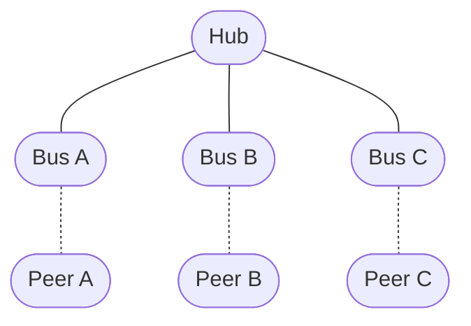
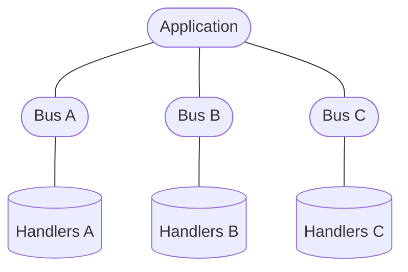
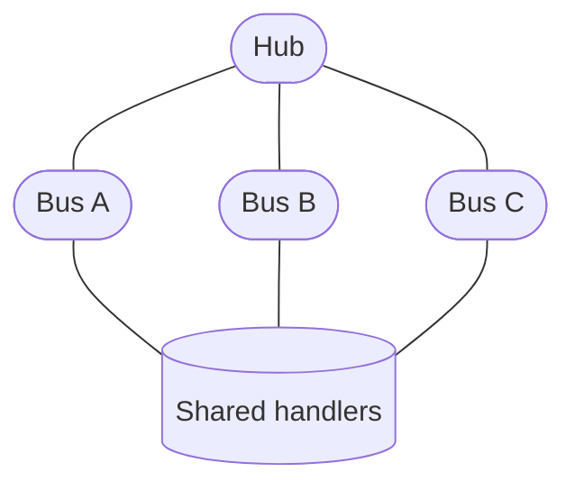
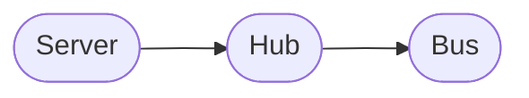
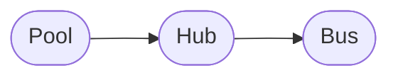

# `Hub`

`Hub` is a low-level container for multiple [`Bus`](./bus.md) instances.

A `Hub` does not represent a connection itself. Instead, it groups multiple connections and provides shared request handlers, data-event handlers, event listeners, and lifecycle management for all connections it creates.

It is primarily intended as a building block for higher-level abstractions such as [`Server`](./server.md) and [`Pool`](./pool.md), or for advanced users implementing their own connection manager.

## Connection model

A `Bus` represents exactly one connection:



The `Hub` does not replace these `Bus` instances. Each connection remains an independent `Bus`.

::: tip This distinction is important:
`Bus` represents a connection. `Hub` represents a group of connections.
:::

## Shared handlers

A `Hub` provides a single set of request and data-event handlers shared by all buses created by it.

Register a request handler with `onRequest()`:

```ts
hub.onRequest("user", async (data, bus) => {
  return await getUser(data.id);
});
```

The handler receives the `Bus` associated with the request as its `thisArg`.

This allows the same handler to serve multiple connections while still providing access to the connection that initiated the request.

For example:

```ts
hub.onRequest("user", async (data, bus) => {
  console.log("Request received from:", bus);

  return await getUser(data.id);
});
```

The handler registry is shared between all buses created by the hub.

### Data events

Data-event handlers are shared in the same way:

```ts
hub.onDataEvent("message", (data, bus) => {
  console.log("Message received:", data);
});
```

The `bus` argument identifies the connection that delivered the event.

This makes it possible to implement connection-independent application logic while still allowing handlers to distinguish between individual peers when necessary.

## Creating a `Bus`

Use `create()` to create a new `Bus` owned by the hub.

```ts
const bus = hub.create({
  outscope,
  transport,
  serializer,
  lock,
});
```

Unlike a [`Client`](./client.md), the `Hub` does not define connection configuration itself.

All properties required to construct the `Bus` are provided to `create()`.

This allows every connection to have its own:

- execution scope;
- transport;
- serializer;
- liveness monitor;
- exclusive-lock implementation;
- response timeout;
- other connection-specific configuration.

`create()` is synchronous. It constructs and registers the `Bus`, but does not start it.

The returned `Bus` can be started and stopped independently:

```ts
const bus = hub.create(props);

await bus.start();
```

Once started, the returned `Bus` can be used directly:

```ts
await bus.request("user", { id: 42 });

bus.dataEvent("notification", {
  message: "Hello",
});
```

The `Hub` does not proxy or abstract away the `Bus` API.

## Connection ownership

A `Bus` created by `Hub.create()` is owned by that hub.

The hub tracks buses participating in an active lifecycle. A bus enters this collection when it starts connecting and leaves it when it begins disconnecting or finishes disconnecting.

Consequently, `hub.size` includes buses that are still connecting, not only fully established connections.

```ts
const bus = hub.create(props);

console.log(hub.size); // 0

const starting = bus.start();

console.log(hub.size); // 1

await starting;

console.log(hub.size); // 1

await bus.stop();

console.log(hub.size); // 0
```

The hub automatically updates its collection as buses transition through their lifecycle. The caller does not need to manually register or unregister connections.

### Checking ownership

Use `has()` to check whether a `Bus` was created by a particular hub:

```ts
const bus = hub.create(props);

console.log(hub.has(bus)); // true
```

This check concerns ownership, not the current lifecycle state. It remains `true` even after the bus has been stopped.

## Disposing the hub

Use `dispose()` to stop all buses currently participating in an active lifecycle:

```ts
await hub.dispose();
```

The returned promise resolves after all buses included in that disposal operation have finished stopping.

`dispose()` does not permanently disable the hub. It also does not prevent new buses from being created while disposal is in progress.

This means that controlling the overall shutdown sequence is the caller's responsibility. If no new connections should be created during shutdown, the application must enforce that restriction itself.

```ts
await hub.dispose();

console.log(hub.size); // 0
```

Assuming no new buses enter an active lifecycle during disposal, size becomes 0 after the returned promise resolves.

A hub can be reused after disposal:

```ts
await hub.dispose();

const bus = hub.create(props);
await bus.start();
```

The set of buses to stop is captured when `dispose()` is called. Buses created or started afterward are not included in that disposal operation.

## Connection count

The `size` property returns the number of buses currently participating in an active lifecycle.

```ts
console.log(hub.size);
```

A bus is counted from the beginning of its connection transition until it starts disconnecting or finishes disconnecting.

The value changes automatically as buses transition through their lifecycle.

## Events

A `Hub` provides event listeners shared by all buses it owns.

```ts
hub.addEventListener("connected", (bus) => {
  console.log("Connection established", bus);
});

hub.addEventListener("disconnected", (bus) => {
  console.log("Connection closed", bus);
});

hub.addEventListener("error", (bus, error) => {
  console.error("Connection error", bus, error);
});
```

The listener receives the affected `Bus` as its first argument.

The same listener can therefore observe the lifecycle of every connection managed by the hub.

Remove a listener with `removeEventListener()`:

```ts
hub.removeEventListener("disconnected", onDisconnect);
```

See the [`Bus` event documentation](./bus.md) for the available event types and their semantics.

## `extra`

The `extra` property provides application-defined storage associated with the hub:

```ts
hub.extra.someValue = value;
```

`@shinka-rpc/core` does not assign any semantics to its contents.

Unlike `Bus.extra`, which belongs to an individual connection, `Hub.extra` belongs to the hub itself and can be used for state shared by the connection manager.

## Hub and Bus

The distinction between the two is fundamental:

| | `Bus` | `Hub` |
| --- | --- | --- |
| Represents | One connection | A group of connections |
| Request handlers | Connection-facing | Shared by all buses |
| Data-event handlers | Connection-facing | Shared by all buses |
| Event listeners | One connection | All owned connections |
| Lifecycle | One connection | Tracks all active connections |
| `extra` | Per connection | Per hub |
| `size` | — | Number of buses in an active lifecycle |

A `Hub` does not proxy or abstract away the `Bus` API. `create()` returns the actual `Bus` representing the newly created connection.

## Why `Hub` exists

Without a `Hub`, an application managing multiple connections would have to duplicate connection-level configuration and handler registration:



A `Hub` allows those connections to share the same application-level handlers and event listeners:



Each connection remains independent, while the logic responsible for handling connections can be defined once.

## Typical use

`Hub` is particularly useful when implementing abstractions where multiple independent connections belong to the same logical component.

For example, a connection manager can create buses dynamically:

```ts
const hub = new Hub();

hub.onRequest("meta", async () => {
  return await getMetadata();
});

const busA = hub.create({
  outscope,
  transport: transportA,
  serializer,
});

const busB = hub.create({
  outscope,
  transport: transportB,
  serializer,
});

await Promise.all([
  busA.start(),
  busB.start(),
]);
```

Both connections now use the same request handlers, while each `Bus` retains its own connection-specific configuration and state.

## Advanced API

`Hub` is intentionally a relatively low-level abstraction.

Most applications should use [`Client`](./client.md), [`Server`](./server.md), or [`Pool`](./pool.md) instead of constructing a `Hub` directly.

`Hub` is useful when the application needs to define its own connection-management semantics while retaining the common `@shinka-rpc/core` primitives.

The library itself uses `Hub` as a building block:





In these abstractions, `Hub` is responsible for the common mechanics of owning multiple connections, while the higher-level object defines how those connections are created and used.
