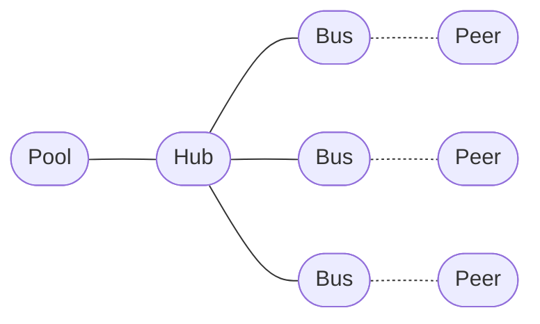

# Pool

`Pool` is an advanced connection manager for maintaining a reusable set of one-to-one connections.

Unlike [`Hub`](./hub.md), which exposes and manages individual [`Bus`](./bus.md) instances, `Pool` manages a collection of connections and provides them to consumers on demand.



A connection acquired from the pool is exclusively owned by the caller until it is disposed. Once released, the connection becomes available for another consumer.

`Pool` is primarily intended for advanced use cases and as a building block for higher-level abstractions such as [`Server`](./server.md). Most applications should not need to use it directly.

## Installation

```bash
npm install @shinka-rpc/core
```

## Creating a Pool

A pool requires an `OutScope`, a transport, and a scheduler.

```ts
import { Pool } from "@shinka-rpc/core";

const pool = new Pool({ outscope, transport, scheduler });
```

See [`@shinka-rpc/outscope`](../outscope.md) for `OutScope`.

See [Transport documentation](../transports/) for transports.

See [Serializer documentation](../serializers/) for serializers.

See [LiMon documentation](../limons/) for liveness monitoring.

See [Exclusive Lock documentation](../exclusive-lock.md) for exclusive locking.

## Pool size

The pool size is controlled through the `size.target` property.

```ts
pool.size.target = 5;
```

This requests a pool containing five connections.

The target can be changed dynamically:

```ts
pool.size.target = 10;
pool.size.target = 3;
```

Increasing the target creates additional connections. Decreasing it stops available connections until the actual pool size approaches the new target.

Changing the target is asynchronous internally, but assigning it does not return a promise. The pool may temporarily contain more or fewer connections than requested while creation and shutdown operations are in progress.

The `size` property exposes four values:

| Property   | Description                                                                                    |
| ---------- | ---------------------------------------------------------------------------------------------- |
| `target`   | The requested number of connections. Can be assigned to change the pool size.                  |
| `actual`   | The current number of created connections, including connections that are still transitioning. |
| `ready`    | The number of connections currently available for acquisition.                                 |
| `acquired` | The number of connections currently acquired by consumers.                                     |

For example:

```ts
pool.size.target = 5;

console.log(pool.size.target);
console.log(pool.size.actual);
console.log(pool.size.ready);
console.log(pool.size.acquired);
```

`actual`, `ready`, and `acquired` are read-only.

A connection that is acquired is not counted as ready. A connection that is not currently started is also excluded from the ready count.

The pool converges toward the requested target as asynchronous operations complete and acquired connections are released.

## Acquiring a connection

Use `acquire()` to obtain an available connection:

```ts
const bus = await pool.acquire();

await bus.request("get-data", {});
```

If all connections are currently in use or unavailable, `acquire()` waits until a connection becomes available.

The returned object is a `BusProxy`, which exposes the same communication API as a `Bus` and additionally implements the disposal protocol.

## Releasing a connection

A connection must be released after use.

The recommended approach is JavaScript's explicit resource management:

```ts
using bus = await pool.acquire();

await bus.request("get-data", {});
```

When the scope ends, the connection is automatically returned to the pool.

The proxy can also be disposed explicitly:

```ts
const bus = await pool.acquire();

try {
  await bus.request("get-data", {});
} finally {
  bus.dispose();
}
```

After `dispose()` has been called, the proxy can no longer be used.

Its methods will throw instead of accessing the underlying connection.

## Scheduler

The pool does not define how available connections are selected.

Instead, it receives a scheduler:

```ts
type IScheduler<T> = {
  push: (value: T) => void;
  pop: () => Promise<T>;
};
```

The scheduler controls which available connection is returned by `acquire()` and how callers wait when no connection is available.

This makes the connection-selection strategy replaceable.

For example, a scheduler can implement:

- FIFO;
- LIFO;
- round-robin-like rotation;
- priority-based selection;
- custom scheduling policies.

A scheduler operates on pool entries containing the connection, its internal lifecycle callback, its release function, and state flags:

```ts
type PoolEntry<SO, TO> = [
  IBus<SO, TO>,
  (bus: IBus<SO, TO>) => void,
  () => void,
  0 | 1,
  0 | 1,
];
```

The tuple is an internal pool entry type. Its state flags are managed by the pool and should not be modified by the scheduler.

The scheduler is responsible only for scheduling entries. The pool remains responsible for creating, stopping, acquiring, and releasing connections.

## Requests and data events

`Pool` exposes the same user-level request and data-event handlers as `Hub`.

```ts
pool.onRequest("get-data", async (data, bus) => {
  return await getData(data);
});
```

The `bus` argument identifies the connection that received the request.

Data events can be handled in the same way:

```ts
pool.onDataEvent("message", (data, bus) => {
  console.log("Received from:", bus);
  console.log(data);
});
```

Handlers are shared by all connections managed by the pool.

## Connection events

Connection lifecycle events are also shared across the pool:

```ts
pool.addEventListener("connected", (bus) => {
  console.log("Connected:", bus);
});

pool.addEventListener("disconnected", (bus) => {
  console.log("Disconnected:", bus);
});

pool.addEventListener("error", console.error);
```

These events are delegated to the underlying [`Hub`](./hub.md).

The pool manages connection recovery internally. A disconnected connection is not available for acquisition until it has been started again.

## Communication through an acquired connection

An acquired `BusProxy` provides the regular bus communication API:

```ts
using bus = await pool.acquire();

await bus.request("get-data", data);

bus.dataEvent("status", { state: "ready" });

const latency = await bus.ping();
```

It can also be restarted or stopped when required:

```ts
using bus = await pool.acquire();

await bus.restart();
```

The proxy exposes:

- `request()`
- `dataEvent()`
- `start()`
- `stop()`
- `restart()`
- `ping()`
- `exclusiveLock()`
- `addEventListener()`
- `removeEventListener()`
- `extra`
- `dispose()`

The communication methods operate on the specific connection acquired by the caller.

## Bidirectional communication

A pool does not restrict communication to requests initiated by the pool.

Remote peers can send requests and data events to any connection managed by the pool, regardless of whether that connection is currently acquired.

For example:

```ts
pool.onRequest("message", async (data, bus) => {
  console.log("Received from peer:", data);

  bus.dataEvent("ack", { received: true });
});
```

This distinction is important: **acquisition controls local ownership of a connection, not whether the connection can receive remote messages.**

## Example

```ts
import { Pool } from "@shinka-rpc/core";
import { FIFO } from "@shinka-rpc/collections";
import { Asynq } from "@shinka-rpc/concurrency";

const pool = new Pool({
  outscope,
  transport,
  scheduler: new Asynq({ items: FIFO, waiters: FIFO }),
});

pool.size.target = 5;

using bus = await pool.acquire();

const result = await bus.request("get-data", { id: 42 });

console.log(result);
```

When the `using` block ends, the connection is returned to the pool and can be acquired by another consumer.

## Configuration

```ts
type PoolProps<SO, TO, TC> = ClientProps<SO, TO, TC> & {
  scheduler: IScheduler<PoolEntry<SO, TO>>;
};
```

The pool accepts the connection configuration used to create its underlying buses, along with a required scheduler.

### `outscope`

Defines the lifetime of the execution scope in which the pool operates.

See [`@shinka-rpc/outscope`](../outscope.md).

### `transport`

The transport used to create each connection in the pool.

See [Transport documentation](../transports/).

### `serializer`

The serializer used by connections created by the pool.

See [Serializer documentation](../serializers/).

### `scheduler`

Controls how available connections are selected and how pending `acquire()` calls are queued.

This option is required.

### `limon`

Configures the optional Liveness Monitor for connections created by the pool.

See [LiMon documentation](../limons/).

### `lock`

Configures the exclusive-lock implementation used by connections created by the pool.

See [Exclusive Lock documentation](../exclusive-lock.md).

### `responseTimeout`

Specifies the default request timeout for connections created by the pool.

If omitted, the package default is used.

## API

### `acquire()`

Acquires an available connection from the pool.

```ts
pool.acquire(): Promise<DisposableIBus<SO, TO>>
```

The promise remains pending until a connection becomes available.

The returned proxy must be disposed after use.

### `size`

Gets the pool size information and allows changing the target size.

```ts
pool.size: PoolSize
```

The `PoolSize` interface is:

```ts
type PoolSize = {
  target: number;
  ready: number;
  actual: number;
  acquired: number;
};
```

Assigning a new value to `target` requests a resize:

```ts
pool.size.target = 5;
```

The target must be a non-negative safe integer. Otherwise, the setter throws an error.

Resizing is asynchronous. The setter does not return a promise, and the actual size may temporarily differ from the target.

### `onRequest()`

Registers a request handler shared by all connections.

```ts
pool.onRequest(key, callback, metadata?)
```

### `onDataEvent()`

Registers a data-event handler shared by all connections.

```ts
pool.onDataEvent(key, callback);
```

### `addEventListener()`

Registers a connection lifecycle event listener.

```ts
pool.addEventListener(type, listener);
```

### `removeEventListener()`

Removes a connection lifecycle event listener.

```ts
pool.removeEventListener(type, listener);
```

### `extra`

An application-defined object shared with the underlying hub.

```ts
pool.extra.someValue = value;
```

`extra` is not interpreted by `@shinka-rpc/core`.

## Pool vs. Hub

Both `Pool` and `Hub` manage multiple connections, but they solve different problems.

|                      | `Hub`                    | `Pool`               |
| -------------------- | ------------------------ | -------------------- |
| Primary purpose      | Manage connections       | Reuse connections    |
| Connection access    | Directly through `Bus`   | Through `acquire()`  |
| Connection ownership | Application-managed      | Pool-managed         |
| Scheduling           | Not required             | Required             |
| Reuse                | Manual                   | Built in             |
| Release              | `Bus.stop()` / lifecycle | `dispose()`          |
| Typical use          | Connection management    | Concurrent workloads |

A `Hub` is appropriate when the application needs to manage individual connections directly.

A `Pool` is appropriate when the application needs a bounded set of reusable connections and multiple consumers need access to them.

## Advanced usage

`Pool` is intentionally a low-level abstraction. It exposes scheduling and connection-management primitives rather than prescribing a particular pooling strategy.

Most applications should use [`Client`](./client.md) for one-to-one communication or [`Server`](./server.md) for higher-level server-side connection management.

Use `Pool` directly when the application needs explicit control over:

- pool size;
- connection acquisition;
- connection reuse;
- scheduling policy;
- connection-level ownership;
- shared request and event handlers.
