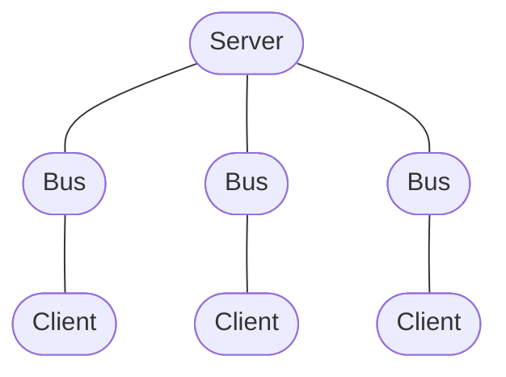
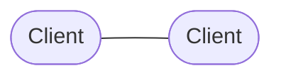
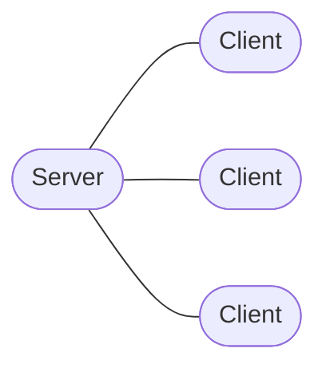

# `Server`

`Server` represents the server side of a one-to-many communication relationship.

Unlike [`Client`](./client.md), which represents a single one-to-one communication endpoint, `Server` accepts connections from multiple peers and creates a separate [`Bus`](./bus.md) for each connection.

A `Server` is typically the entry point for accepting incoming connections. Each accepted connection is represented by its own `Bus`, while request and event handlers can be registered once on the server and shared by all connections.

## Basic usage

```ts
import express from "express";
import http from "node:http";
import { WebSocketServer } from "ws";

import { Server } from "@shinka-rpc/core";
import outscope from "@shinka-rpc/outscope/node-process";
import { webSocketServer } from "@shinka-rpc/web-socket";

const app = express();
const httpServer = http.createServer(app);
const wss = new WebSocketServer({ server: httpServer, path: "/ws" });

const server = new Server({
  outscope,
  transport: webSocketServer(wss),
});

server.onRequest("meta", async () => {
  return { version: "1.0.0" };
});

server.onDataEvent("log", (data, bus) => console.log("Client:", data));
server.addEventListener("error", console.error);

await server.start();
```

The exact transport implementation is independent of `Server`. See the [transport documentation](../transports/) for details.

## Connection model

`Server` represents a **one-to-many** relationship:



Every accepted connection gets its own `Bus`.

The `Bus` is the representation of the actual connection. Consequently, handlers registered on the server receive the corresponding `Bus` as their `thisArg`:

```ts
server.onRequest("user", async (data, bus) => {
  // `bus` represents the connection that sent the request.
});
```

This makes it possible to distinguish clients and communicate with a specific connection.

For example:

```ts
server.onDataEvent("message", (data, bus) => {
  bus.dataEvent("message", { received: data });
});
```

See the [`Bus` documentation](./bus.md) for details about connection-level operations.

## `Server` vs `Client`

`Client` and `Server` describe different **communication relationships**, not necessarily different runtime roles.

`Client` represents **one-to-one** communication:



`Server` represents **one-to-many** communication:



The name of the transport does not determine whether an endpoint is a `Client` or a `Server`.

For example, with a `DedicatedWorker`, both sides can be represented by `Client`, because there is only one peer on each side. A `Server` is appropriate when one endpoint manages multiple independent connections.

## Constructor

```ts
new Server({
  outscope,
  transport,
  serializer,
  limon,
  responseTimeout,
  lock,
  complete,
});
```

### `outscope`

```ts
outscope: OutScope
```

Defines the lifetime of the execution scope in which the server operates.

`Server` does not assume a particular runtime or lifecycle API. The supplied `OutScope` implementation determines when the surrounding execution scope ends.

See the [`@shinka-rpc/outscope` documentation](../outscope.md).

This option is required.

### `transport`

```ts
transport: TransportServer<SO, TO, any>
```

Server-side transport implementation.

The transport is responsible for accepting incoming connections and notifying `Server` when a new connection is available. `Server` then creates a `Bus` for that connection.

The transport is deliberately independent from the `Server` abstraction and can be implemented over different communication mechanisms.

See the [transport documentation](../transports/).

This option is required.

### `serializer`

```ts
serializer?: SerializerRoot<SO, TO, any>
```

Defines how messages are serialized and deserialized.

If omitted, the default serializer is used.

See the [serializer documentation](../serializers/).

### `limon`

```ts
limon?: LiMon<SO, TO, any> | null
```

Optional liveness monitoring for individual connections.

When configured, each `Bus` created by the server gets its own LiMon instance.

See the [LiMon documentation](../limons/).

### `responseTimeout`

```ts
responseTimeout?: number
```

Maximum amount of time allowed for a request to receive its response.

The default value is used when the option is omitted.

### `lock`

```ts
lock?: ExclusiveLock<SO, TO, any>
```

Implementation of the exclusive-lock mechanism used by connections managed by the server.

The default implementation is used when omitted.

See the [exclusive lock documentation](../exclusive-lock.md).

### `complete`

Optional callback forwarded to the `Bus` instances created by the server.

See the [`Bus` documentation](./bus.md) for details.

## Request handlers

Use `onRequest` to handle requests sent by connected peers.

```ts
server.onRequest("meta", async () => {
  return await getMetadata();
});
```

The handler receives the request key, request data, and the `Bus` representing the connection that sent the request.

```ts
server.onRequest("user", async (data, bus) => {
  console.log("Request from:", bus);

  return await getUser(data);
});
```

Handlers are shared by all connections managed by the server.

This means that you normally register a handler once rather than registering it separately for every connection.

## Data event handlers

Use `onDataEvent` to handle one-way data events.

```ts
server.onDataEvent("message", (data, bus) => console.log("Received:", data));
```

Unlike requests, data events do not expect a response.

The `Bus` argument identifies the connection that produced the event.

## Event listeners

`Server` exposes connection-level event listeners inherited from its internal connection manager:

```ts
server.addEventListener("connecting", (bus) => {
  console.log("Connection is being established", bus);
});

server.addEventListener("connected", (bus) => {
  console.log("Connection established", bus);
});

server.addEventListener("disconnecting", (bus) => {
  console.log("Connection is closing", bus);
});

server.addEventListener("disconnected", (bus) => {
  console.log("Connection closed", bus);
});

server.addEventListener("error", (bus, error) => {
  console.error("Connection error", error);
});
```

These events concern individual `Bus` instances managed by the server.

In addition, `Server` exposes its own lifecycle events, described below.

## Server lifecycle

`Server` has two lifecycle states:

- `STOPPED`: the server is not accepting connections.
- `STARTED`: the server is accepting connections.

Transitions between these states are asynchronous from the API perspective, even though starting the server itself does not require waiting for an asynchronous operation.

The lifecycle is designed to tolerate repeated and overlapping calls to `start()` and `stop()`.

### `start()`

```ts
await server.start();
```

Enables the server and begins accepting new connections.

Starting the server is synchronous internally: it enables the connection callback and notifies the transport that the server has started. It does not wait for clients to connect.

The returned promise represents completion of the lifecycle transition, not the establishment of any client connections.

Calling `start()` when the server is already started is a no-op.

Concurrent calls targeting the same transition are coalesced and share the ongoing transition.

If an opposite transition is already in progress, the requested transition waits for it to finish before proceeding.

If starting the server fails, `start()` rejects and the server's lifecycle state returns to its previous state (`STOPPED`).

The server also schedules cleanup of the failed startup. This cleanup is performed separately from the rejected startup transition.

### `stop()`

```ts
await server.stop();
```

Disables the server and disposes of all currently managed connections.

The shutdown sequence is:

1. Notify the transport that the server is stopping.
2. Disable the connection callback so that no new connections can be accepted.
3. Dispose of all connections managed by the internal `Hub`.
4. Notify the transport that the server has stopped.

After `stop()` completes, the server is in the stopped state and can be started again.

Calling `stop()` when the server is already stopped is a no-op.

Concurrent calls targeting the same transition are coalesced.

### Repeated and overlapping transitions

`Server` supports repeated lifecycle calls without treating them as errors.

For example:

```ts
const first = server.start();
const second = server.start();

await Promise.all([first, second]);
```

Both calls share the same ongoing startup transition.

Opposite transitions are serialized:

```ts
const starting = server.start();
const stopping = server.stop();

await Promise.all([starting, stopping]);
```

In this example, the stop transition waits for the startup transition to finish before proceeding.

This prevents overlapping startup and shutdown operations from independently modifying the server's lifecycle.

## `size`

```ts
server.size
```

Returns the number of currently managed connections.

```ts
console.log(server.size);
```

The value represents the number of `Bus` instances currently managed by the server.

## Server lifecycle events

`Server` exposes four lifecycle events:

```ts
"enabling" | "enabled" | "disabling" | "disabled"
```

They describe the lifecycle of the **server itself**, rather than individual connections.

The `enabled` event is emitted only after a successful startup transition.

If startup fails, the server returns to the stopped state, performs cleanup,
and emits `disabled` after the cleanup completes.

### `enabling`

Emitted when the server begins transitioning to the started state.

### `enabled`

Emitted after the server has successfully completed its startup transition and is ready to accept connections.

```ts
server.addEventListener("enabled", () => {
  console.log("Server started");
});
```

It does **not** mean that a client has connected.

### `disabling`

Emitted when the server begins transitioning to the stopped state.

At this point, shutdown is being initiated.

```ts
server.addEventListener("disabling", () => {
  console.log("Server is shutting down");
});
```

### `disabled`

Emitted after the shutdown transition has completed.

```ts
server.addEventListener("disabled", () => {
  console.log("Server stopped");
});
```

These events are distinct from the connection-level `connecting`, `connected`, `disconnecting`, and `disconnected` events.

## `enabled`

```ts
server.enabled
```

Returns whether the server has completed its startup transition and is currently in the started state.

```ts
if (server.enabled) {
  console.log("Server is accepting connections");
}
```

The value is derived from the server's internal lifecycle state.

During startup and shutdown transitions, `enabled` is `false`.

## `extra`

```ts
server.extra
```

A user-defined storage object associated with the server.

The library does not assign any semantics to this object, so applications can use it to attach arbitrary state or metadata.

```ts
server.extra.authentication = authenticationService;
```

## Advanced usage

`Server` is built on top of [`Hub`](./hub.md), which manages the collection of connection-level `Bus` instances.

Most applications should use `Server` directly. `Hub` is exposed primarily for advanced use cases where the application needs to manage connection creation independently from a specific server transport.

See the [`Hub` documentation](./hub.md).
