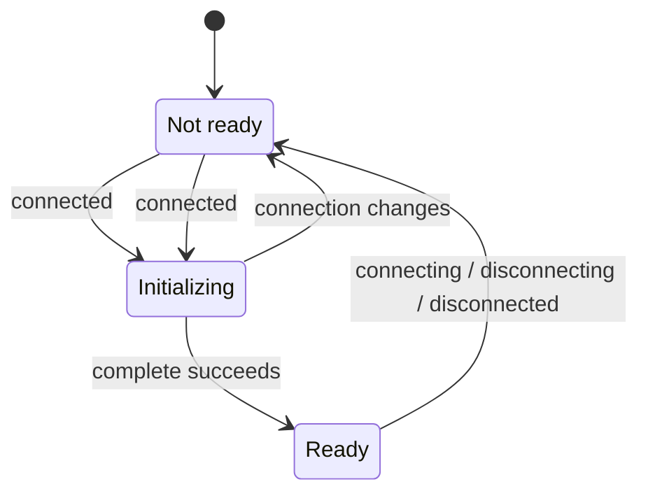

# `readinessBarrier`

`readinessBarrier` creates a reusable asynchronous barrier that represents the
readiness of an `IBus`.

A bus being connected does not necessarily mean it is ready for use. The
application may need to authenticate, refresh credentials, or perform other
connection-specific initialization before sending requests.

`readinessBarrier` provides a way to coordinate these operations without
coupling application logic to the bus lifecycle events.

## Usage

```ts
import { readinessBarrier } from "@shinka-rpc/scenarios";

const ready = readinessBarrier(client, async () => {
  await authenticate(client);
});

await ready;

const data = await client.request("get-data");
```

The returned promise resolves only after the bus has connected and the
`complete` callback has finished successfully.

## API

```ts
function readinessBarrier(
  bus: IBus<any, any>,
  complete?: () => void | Promise<void>,
  onFailure?: (error: any) => void,
): ReusablePromise<void>;
```

| Parameter | Description |
| --- | --- |
| `bus` | The bus whose readiness is being tracked. |
| `complete` | An optional callback executed after each `connected` event. It may perform authentication or other initialization. Defaults to a no-op. |
| `onFailure` | An optional callback invoked when `complete` fails for the current connection. Defaults to a no-op. |

Returns a `ReusablePromise<void>` that can be awaited across multiple connection cycles.

## Lifecycle

The barrier follows the bus lifecycle:

- **`connecting`** — resets the barrier.
- **`connected`** — executes `complete`; the barrier resolves after successful
  completion.
- **`disconnecting`** — resets the barrier.
- **`disconnected`** — resets the barrier.

The barrier is reusable. When the bus disconnects, previously established
readiness is invalidated. After the next connection, `complete` runs again
before the barrier resolves.



## Failure handling

If `complete` throws an exception or returns a rejected promise, the barrier
does not resolve for that connection. The bus is stopped, and `onFailure` is
called with the error.

This allows the application to distinguish between recoverable failures and
failures that require intervention. For example, `complete` may refresh an
expired token and retry authentication itself. If it cannot recover, it can
throw and let `onFailure` decide how the application should respond.

If `onFailure` throws, its exception is not caught by `readinessBarrier`.

A failed initialization does not automatically reject the returned promise. The
barrier remains unresolved until it is reset or otherwise resolved according to
the lifecycle. Applications that need to cancel an ongoing wait should manage
that cancellation separately.

If `complete` never settles, the barrier remains closed. The callback is
responsible for its own timeout and cancellation policies.

## Important

`readinessBarrier` coordinates application code; it does not prevent the bus
from sending requests before the barrier resolves. Operations that require a
ready connection must explicitly await the returned promise.

The implementation also guards against stale asynchronous completions. If the
bus lifecycle changes while `complete` is running, the result of that obsolete
invocation cannot mark a later connection as ready or stop it because of an
outdated failure.
