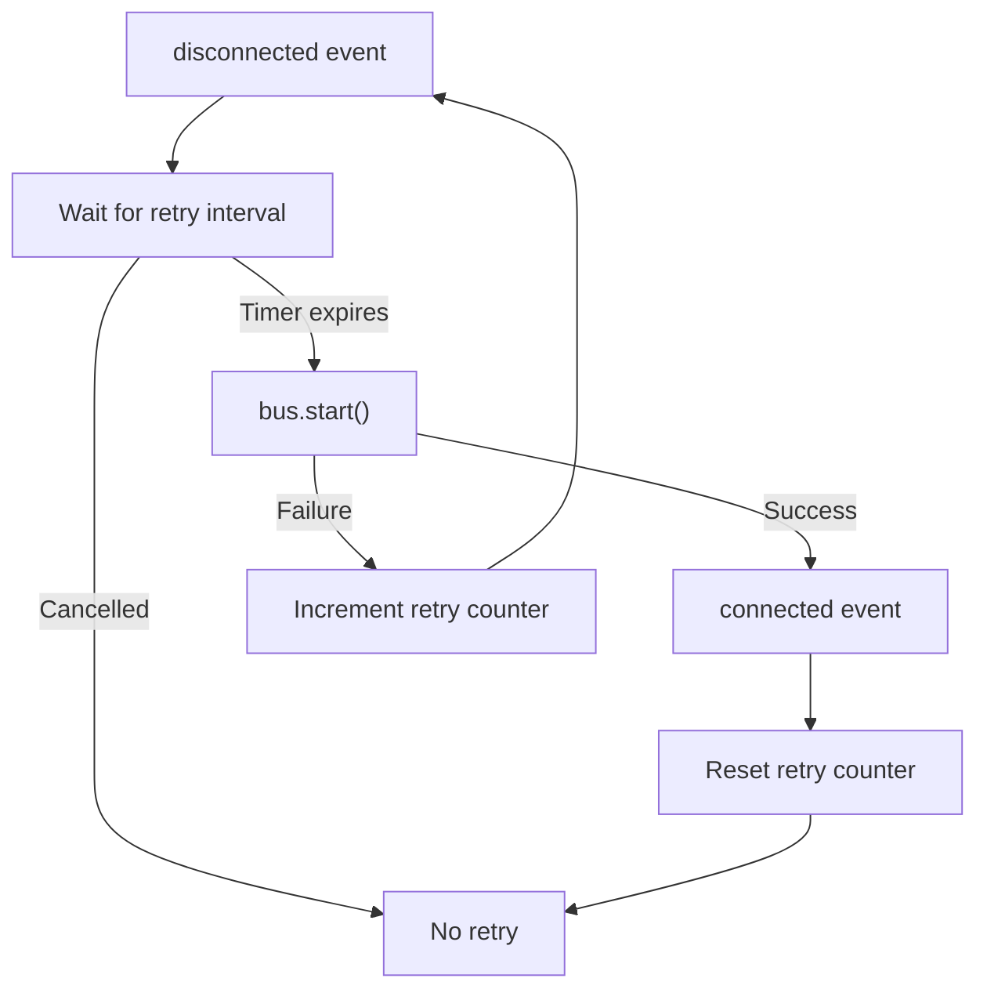

# Reconnect

The `reconnect` helper automatically attempts to restart a `Bus` after it disconnects. It uses a configurable retry interval and resets the retry counter whenever the bus connects successfully.

```ts
import { reconnect } from "@shinka-rpc/scenarios";

const intervalFn = (n: Number) => Math.min(1000 * 2 ** n, 30_000);
const { enable, disable } = reconnect(bus, intervalFn);
```

The interval function receives the number of failed connection attempts since the last successful connection, starting at `0`. It returns the delay in milliseconds before the next attempt. This makes it possible to implement fixed intervals, exponential backoff, or other retry strategies.

## How it works

- When the bus emits `disconnected`, the helper schedules a call to `bus.start()` after the delay returned by the interval function.
- If `bus.start()` fails, the retry counter is incremented. A subsequent `disconnected` event can schedule another attempt.
- When the bus emits `connected`, the retry counter is reset to `0` and any pending delay is cancelled.
- `enable()` subscribes to the bus lifecycle events. It is idempotent: calling it repeatedly does not add duplicate listeners.
- `disable()` removes the listeners and cancels any pending delay. It is also idempotent.

The helper is enabled automatically when created. Use `enable()` and `disable()` to control its lifetime.

## Lifecycle



## Important considerations

**Disable reconnection before intentionally stopping the bus.** The helper treats every `disconnected` event as a reason to reconnect, including disconnections caused by an intentional stop. Call `disable()` before `bus.stop()` when reconnection is no longer desired.

`disable()` cancels a pending wait but does not cancel a `bus.start()` call that has already begun. An in-progress start is still governed by the bus lifecycle.

Use **one reconnect helper per bus**. Creating multiple helpers for the same bus is unintended usage: although the bus lifecycle coordinates concurrent start and stop operations, each helper schedules retries independently. Multiple helpers can therefore cause redundant attempts and competing retry schedules.
