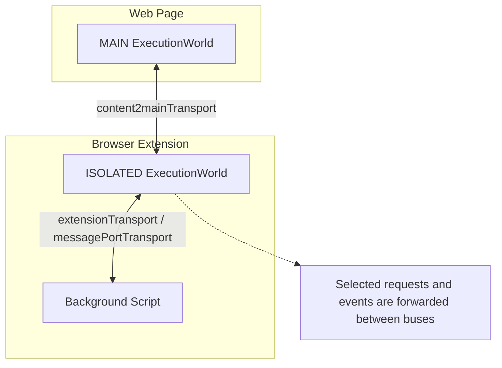
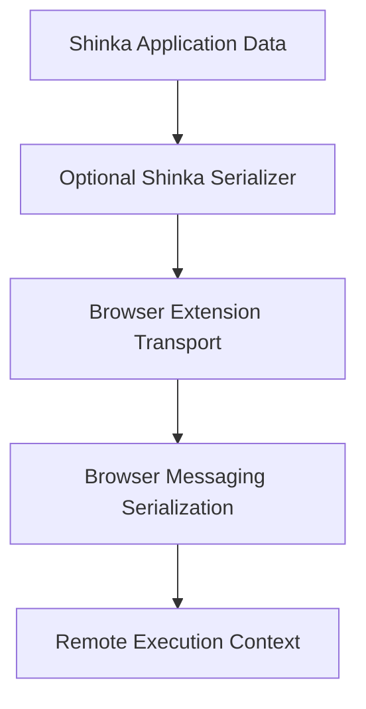

# Browser Extension

`@shinka-rpc/browser-extension` provides transports for communication between different execution contexts of a browser extension.

It allows you to use [@shinka-rpc/core](https://www.npmjs.com/package/@shinka-rpc/core) to establish RPC connections between page scripts, content scripts, and background scripts without implementing browser messaging yourself.

## Architecture

A typical browser extension has three communication contexts / [ExecutionWorld](https://developer.mozilla.org/en-US/docs/Mozilla/Add-ons/WebExtensions/API/scripting/ExecutionWorld)s:

- **Page (`MAIN`)** — the page's JavaScript execution environment.
- **Content script (`ISOLATED`)** — an isolated execution environment injected into the page by the extension.
- **Background** — the extension's background script, acting as a server.

The content script connects to both the page and the background script. It can therefore act as a bridge, forwarding selected requests and events between them.



Other extension interfaces, such as popup pages, options pages, and DevTools panels, run in their own extension contexts. They can also participate in RPC communication when connected through an appropriate transport.

## Usage

### Message identification

Communication between `MAIN` and `ISOLATED` [ExecutionWorld](https://developer.mozilla.org/en-US/docs/Mozilla/Add-ons/WebExtensions/API/scripting/ExecutionWorld)s uses page messaging. Since both environments may exchange messages with the page, it is useful to distinguish messages belonging to your extension from unrelated messages.

Define two message tags:

```typescript
// constants.ts
export const MAIN2ISOLATED = "MY_EXTENSION_MAIN2ISOLATED";
export const ISOLATED2MAIN = "MY_EXTENSION_ISOLATED2MAIN";
```

The two tags identify the direction of communication. Both environments must use matching tags, passed in opposite order.

### Page: `MAIN` ExecutionWorld

The page's `MAIN` execution environment can establish a connection to the content script's `ISOLATED` execution environment.

```typescript
import { Client } from "@shinka-rpc/core";
import outscope from "@shinka-rpc/outscope/browser-page";
import { content2mainTransport } from "@shinka-rpc/browser-extension";

import { MAIN2ISOLATED, ISOLATED2MAIN } from "./constants";

const transport = content2mainTransport( ISOLATED2MAIN, MAIN2ISOLATED);

export const client = new Client({ outscope, transport });
```

The transport arguments specify the tags used to identify incoming and outgoing messages, respectively.

### Content script: `ISOLATED` ExecutionWorld

The content script establishes two independent connections:

- A connection to the page's `MAIN` execution environment.
- A connection to the background script.

This makes it possible to expose selected background functionality to the page without giving the page direct access to extension APIs.

```typescript
import { Client } from "@shinka-rpc/core";
import outscope from "@shinka-rpc/outscope/browser-page";

import { content2mainTransport, extensionTransport } from "@shinka-rpc/browser-extension";
import { passThroughEvents, passThroughRequests} from "@shinka-rpc/scenarios";

import { MAIN2ISOLATED, ISOLATED2MAIN } from "./constants";

// Connect to the page's MAIN execution environment.
//
// The message tags must be passed in reversed order
// compared to the MAIN-side transport configuration.
const contentBusTransport = content2mainTransport(MAIN2ISOLATED, ISOLATED2MAIN);

const contentBus = new Client({ outscope, transport: contentBusTransport});

// Connect to the background script.
const extensionBus = new Client({ outscope, transport: extensionTransport});

// Forward selected events and requests from the page to the background.
passThroughEvents(contentBus, extensionBus, undefined, ["ev1", "ev2"]);
passThroughRequests(contentBus, extensionBus, undefined, ["req1", "req2"]);

// Forward selected events and requests from the background to the page.
passThroughEvents(extensionBus, contentBus, undefined, ["ev3", "ev4"]);
passThroughRequests(extensionBus, contentBus, undefined, ["req3", "req4"]);
```

Both `passThroughEvents` and `passThroughRequests` accept a source bus, a destination bus, optional metadata, and an array of keys to forward.

Forwarding is unidirectional: messages are passed from `source` to `dest`. To enable communication in both directions, register forwarding separately for each direction.

This approach keeps the page-facing API separate from the extension-facing API while allowing the content script to mediate communication between them.

### Background script

The background script acts as a `Server`, accepting connections from content scripts across browser tabs.

```typescript
import { Server } from "@shinka-rpc/core";
import outscope from "@shinka-rpc/outscope/null-scope";
import { messagePortTransport } from "@shinka-rpc/browser-extension";

export const server = new Server({ outscope, transport: messagePortTransport});
```

Each content script establishes its own connection to the background server using `extensionTransport`.

The background script can then handle requests and publish events to connected clients through the regular `@shinka-rpc/core` API.

## Serialization

Browser messaging APIs apply their own serialization when transferring messages between execution contexts. The supported data types depend on the browser and its configuration.

- **Firefox** uses the Structured Clone algorithm.
- **Chrome** uses JSON serialization by default. Starting with Chrome 148, extensions can opt into Structured Clone using the `message_serialization` manifest key.

JSON serialization has more restrictive data type support. In particular, it does not provide native representation for binary data such as `ArrayBuffer` and typed arrays.

If your application needs to exchange binary data or other values that are not compatible with JSON serialization, consider using a custom serializer, such as [`@shinka-rpc/serializer-base64`](https://www.npmjs.com/package/@shinka-rpc/serializer-base64).

A text-based serializer can encode such values into a representation compatible with browser messaging APIs, avoiding differences between their underlying serialization mechanisms.

Choose the serializer according to your data requirements and browser compatibility targets. No custom serializer is required when your messages contain only values supported by the underlying browser messaging APIs.


