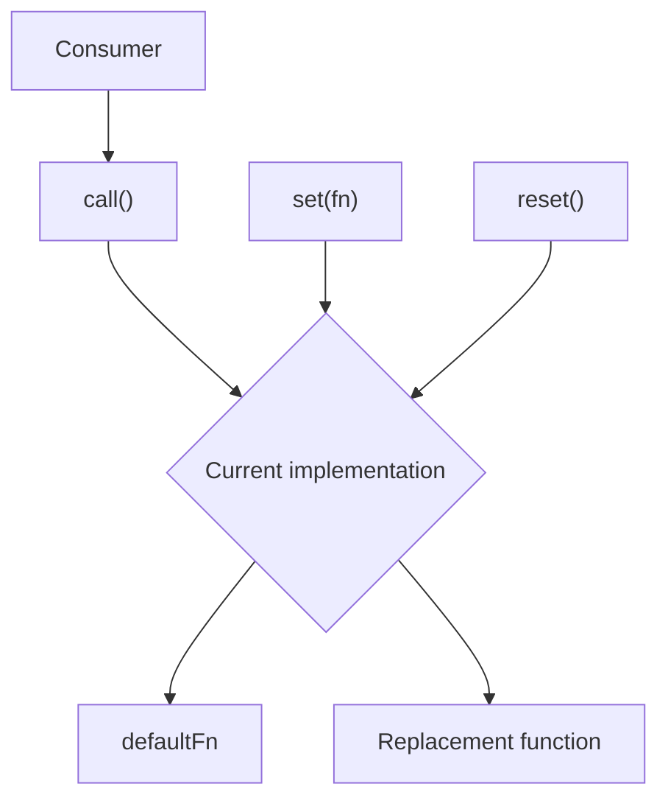

## `delegate`

Creates a function delegate that supports late binding.

A delegate provides a stable function reference whose actual implementation can be replaced at runtime. This is particularly useful for resolving circular dependencies and implementing deferred dependency injection.

### Usage

```typescript
import { delegate } from "@shinka-rpc/util";

const defaultFn = () => {
  throw new Error("Implementation is not ready!");
};

const { call, set, reset } = delegate(defaultFn);

const dependency1 = new Dependency1(call);
const dependency2 = new Dependency2(dependency1);

// Resolve the circular dependency
set(dependency2.someMethod.bind(dependency2));

// dependency1 can now use dependency2.someMethod through call()
```

The `call` function can be passed to other objects before the actual implementation is available.

Once `set()` is called, subsequent invocations are forwarded to the new implementation without changing the identity of `call`.

### How it works



The delegate maintains two function references:

- `defaultFn` — the initial implementation, retained for subsequent resets.
- `current` — the implementation currently receiving calls.

The `call` function always forwards its arguments to `current` and returns its result.

### API Reference

```typescript
type AnyFn = (...args: any[]) => any;

type DelegateType<T extends AnyFn> = {
  call: T;
  set: (value: T) => void;
  reset: () => void;
};

function delegate<T extends AnyFn>(
  defaultFn: T,
): DelegateType<T>;
```

**Parameters:**

| Parameter | Type | Description |
|---|---|---|
| `defaultFn` | `T` | Initial implementation and fallback implementation restored by `reset()`. |

**Returns:** `DelegateType<T>` — an object containing:

| Property | Type | Description |
|---|---|---|
| `call` | `T` | Stable forwarding function that invokes the current implementation. |
| `set` | `(value: T) => void` | Replaces the current implementation. |
| `reset` | `() => void` | Restores the initial implementation. |

### Notes

- `call` retains the same function identity regardless of changes made through `set()` or `reset()`.
- The delegate preserves the argument and return types of the original function.
- The return value and thrown exceptions of the current implementation are propagated directly.
- The delegate does not automatically preserve the `this` context of the current implementation. Use `Function.prototype.bind()` when a specific context is required.
- Until `set()` is called, invocations are forwarded to `defaultFn`.
