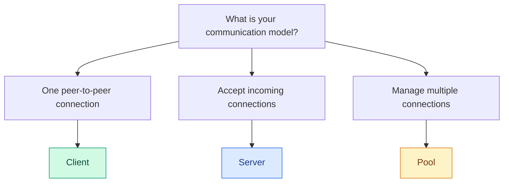

# Choosing a Component

Shinka-RPC provides three high-level components for managing communication between peers. Choose the one that best matches your application's communication model.

## [Client](../api-reference/core/client)

A [`Client`](../api-reference/core/client) represents a single peer-to-peer connection. Use it when your application needs to communicate with one remote peer.

## [Server](../api-reference/core/server)

A [`Server`](../api-reference/core/server) accepts and manages incoming connections from remote peers. Use it when your application needs to expose an RPC endpoint to multiple clients.

## [Pool](../api-reference/core/pool)

A [`Pool`](../api-reference/core/pool) manages a collection of connections and provides controlled access to them. Use it when your application needs to reuse and coordinate multiple connections.

## Which one should I choose?

Each component is built on lower-level Shinka-RPC primitives and can be explored independently.

See the [API Reference](../api-reference/index.md) for detailed documentation, configuration options, and usage examples.
